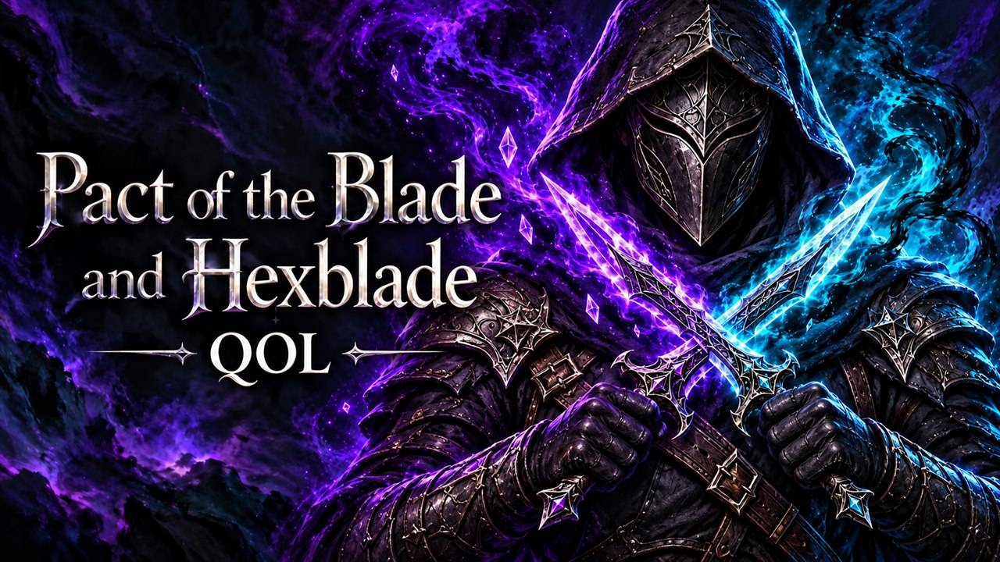

# Pact and Hexblade QoL

Pact of the Blade and Hexblade bind all your equipped weapons; a weapon loses its bind when you unequip it.

> **Do you play with [DnD 5.5e All-in-One BEYOND](https://mod.io/g/baldursgate3/m/bg3dnd)?** Then use
> [Pact and Hexblade QoL - DnD 5.5e BEYOND](https://openmods.nexus/mods/kintaromodding/bg3_pactandhexbladeqol_dnd55ebynd)
> instead of this mod. DnD 5.5e BEYOND replaces the bind spell with four new ones, one per damage type, and this mod
> does not know them.

## What it does

- **Pact of the Blade: Bind** and **Hexblade: Bind** bind every weapon you have equipped: main hand, off hand and
  both ranged slots. The game binds only the main-hand weapon.
- A weapon loses its bind when you unequip it.
- While your summoned pact weapon is equipped, your other equipped weapons are bound too (with the Hexblade bind if
  you are a Hexblade). When you unequip the pact weapon, they lose that bind.
- The bind spells are free and also work in combat. The same goes for the Eldritch Knight's **Weapon Bond**.
- Summoning a pact weapon has no cooldown.

## Screenshots

## How to install

1. Install [Norbyte's Script Extender](https://github.com/Norbyte/bg3se). It updates itself.
2. Download `bg3_pactandhexbladeqol.pak` from the latest release on GitHub.
3. Copy it to `%LOCALAPPDATA%\Larian Studios\Baldur's Gate 3\Mods`.
4. Enable **Pact and Hexblade QoL** in your mod manager (BG3 Mod Manager or the in-game mod manager).

To update the mod, replace the `.pak` with the one from the new release. To remove it, disable it in the mod manager
and delete the `.pak`. Saves made with the mod can then show a warning about a missing mod.

## How to use

Equip the weapons you want, then cast the bind spell as usual. The spell tooltip tells you when a weapon loses its
bind. There is nothing to set up.

## Compatibility

- Game version: Patch 8
- The mod changes only a few fields of five spells (`Shout_PactOfTheBlade`, `Shout_PactOfTheBlade_Hex`,
  `Shout_PactOfTheBlade_Bind`, `Shout_Hexblade_Bind`, `Shout_WeaponBond`), while the game runs. Other changes of these
  spells stay; for the same fields, this mod's values count.
- Do not use it together with another mod that also binds all weapons.
- Not for DnD 5.5e All-in-One BEYOND: with it, the bind spell binds only the main-hand weapon. Use
  [Pact and Hexblade QoL - DnD 5.5e BEYOND](https://openmods.nexus/mods/kintaromodding/bg3_pactandhexbladeqol_dnd55ebynd)
  instead, and never both mods at the same time.

## Known issues

- The status tooltip of a bound off-hand or ranged weapon says "until long rest"; the main-hand weapon says
  "Permanent". Only the label differs: every bind stays after a long rest.

## How to build

Anyone can build this mod from its source code and check that the download matches it.

1. Install the tools: Windows PowerShell 5.1 (part of Windows) and [LSLib](https://github.com/Norbyte/lslib/releases)
   v1.20.4. Put LSLib into a folder `_tools\lslib\` above the repository, or set `BG3_TOOLS` to the folder that holds
   `lslib\`.
2. Build it: `powershell -ExecutionPolicy Bypass -File .\build.ps1`
3. Find the file: `dist\bg3_pactandhexbladeqol.pak`

The offline tests need Python 3 with lupa: `python -m pip install lupa`, then `python tests\run_tests.py`.

## Credits

Made by Kintaro. MIT license: you may use, change and share this mod.
